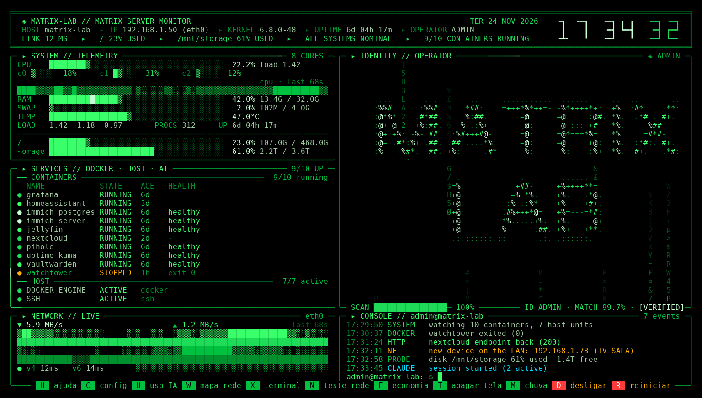
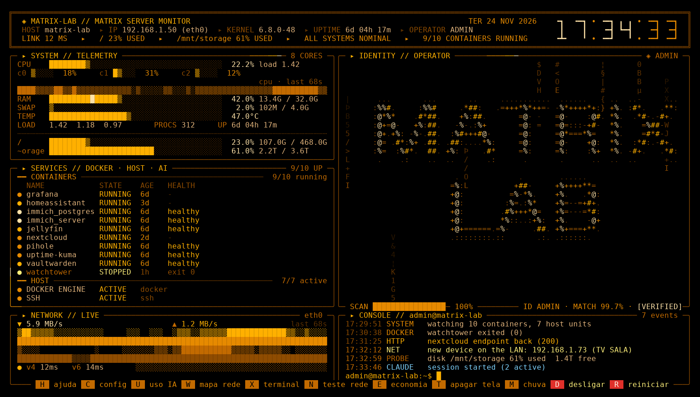
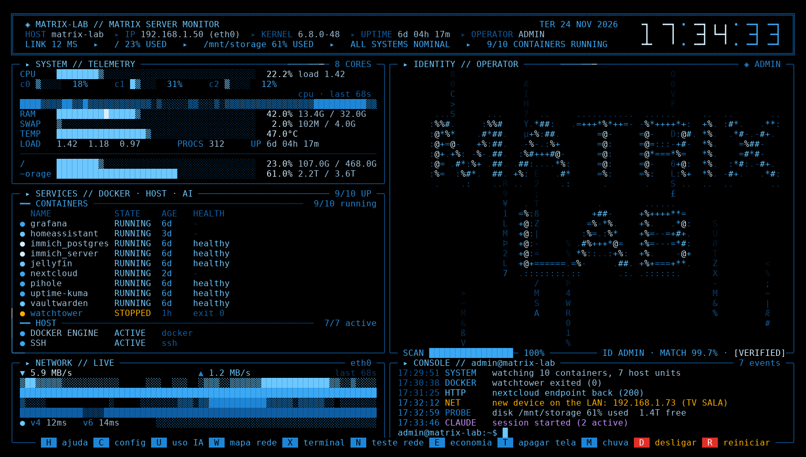
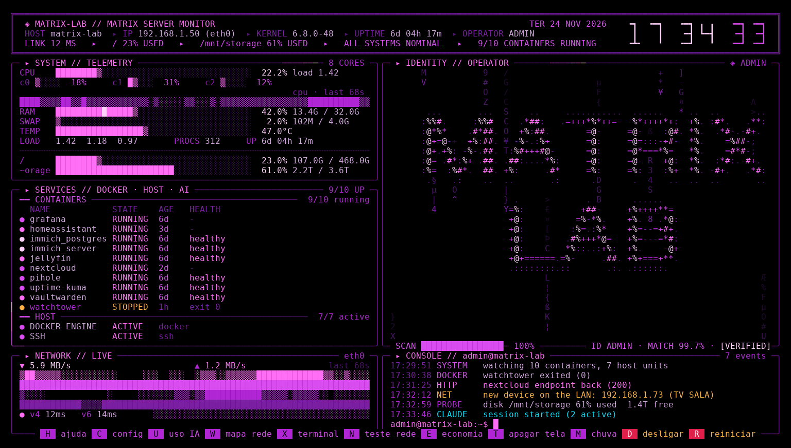
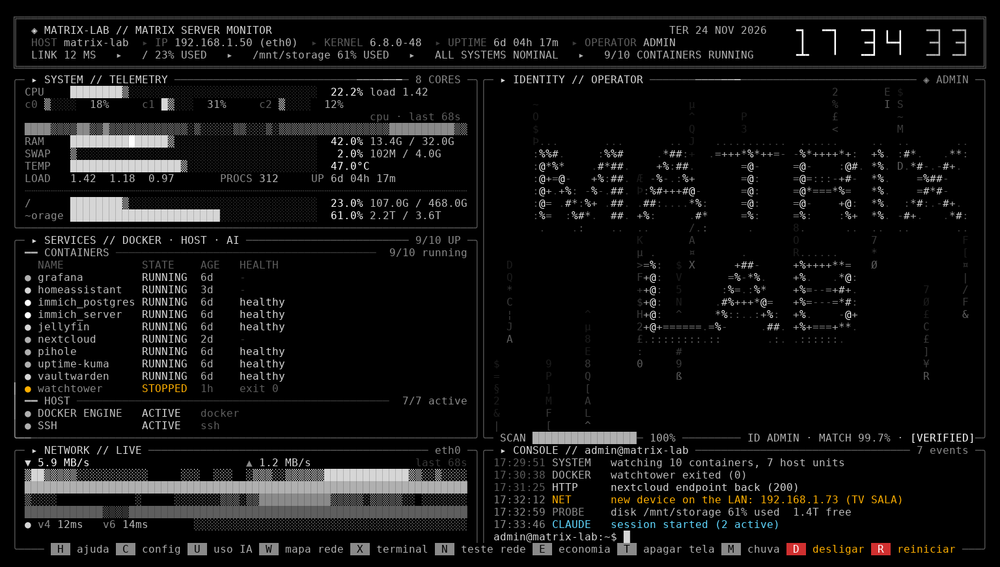
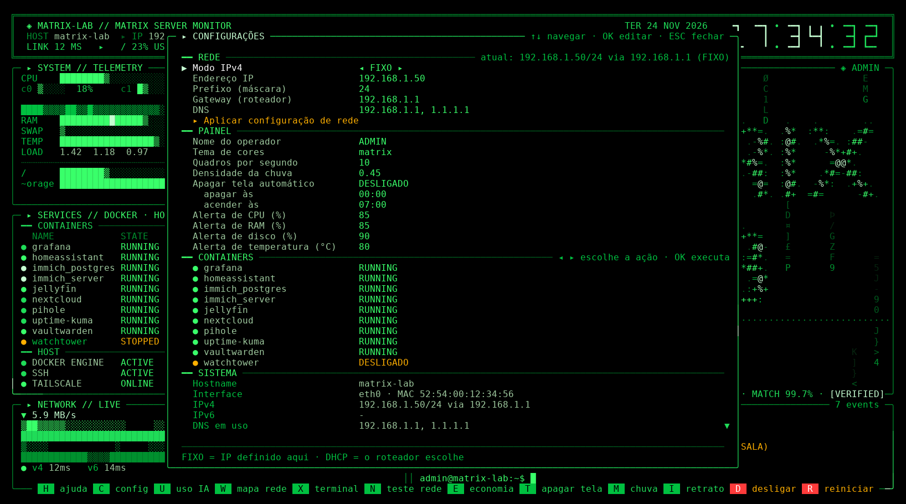

# Matrix Server Dashboard

Painel de monitoramento para servidores Linux com visual Matrix. Roda no **monitor do próprio
servidor** (tty1), **por SSH** ou **no navegador**.

Na instalação você informa só o básico: seu nome, uma foto opcional e se quer acesso web. O resto
é **detectado sozinho** toda vez que o painel inicia: discos, serviços do sistema, containers
Docker e seus endpoints, rede, Tailscale e Claude Code.


<sub>Prints gerados com dados de demonstração (`tools/screenshots.py`).</sub>

## Destaques

- **Zero configuração**: discos, ~35 serviços comuns, todos os containers e um teste HTTP/TCP para
  cada porta publicada. Container novo aparece sozinho.
- **VPNs**: Tailscale e WireGuard com o estado de cada peer e alerta quando um túnel cai.
- **k3s e Argo CD**: workloads do cluster junto com os containers do Docker e as Applications do
  Argo CD com sync, health e o motivo de cada problema (tecla `A`).
- **Telemetria ao vivo**: CPU total e por núcleo, RAM, swap, temperatura, carga, discos, rede
  (download/upload, IPv4/IPv6, latência) com gráficos.
- **Alertas no celular**: Telegram, Discord, ntfy ou webhook, sem spam (só o que dura, um
  aviso por problema, "resolvido" quando acaba).
- **Console de eventos**: container caiu ou subiu, serviço parou, endpoint fora do ar, alerta de
  CPU/RAM/disco, dispositivo novo na rede.
- **Mapa da rede** (`W`): dispositivos da LAN com nome e fabricante, peers do Tailscale e redes
  Docker.
- **Menu de configurações** (`C`): IP fixo/DHCP com rollback automático, alertas, horários,
  reiniciar containers.
- **Espelho web** com acesso limitado à rede local e ao Tailscale; controle e terminal opcionais.
- **Visual**: boot animado, chuva Matrix, retrato ASCII (sua foto ou o nome do servidor) com
  glitch e paleta verde no console.
- Leve: Python puro (psutil + Pillow), coleta em threads e redesenho só do que mudou.

### Temas de cores

Escolha em **`C` → PAINEL → Tema de cores**: troca na hora, no terminal, no monitor (tty1) e
na página web aberta.

| MATRIX | ÂMBAR | GELO |
|---|---|---|
|  |  |  |
| **SYNTHWAVE** | **MONO** | |
|  |  | |

| Boot | Menu de configurações |
|---|---|
|  |  |
| **Atalhos (`H`)** | **Tela pequena / SSH** |
|  |  |

## Instalação rápida

```bash
git clone https://github.com/tiagomoreiraweb/matrix-server-dashboard.git
cd matrix-server-dashboard
./install.sh
./run.sh
```

Requisitos: Linux com systemd (testado em Ubuntu Server 22.04/24.04) e Python 3.10+. O
instalador cria um ambiente isolado em `.venv`; nada é instalado no sistema sem você confirmar.
O passo a passo completo está em [docs/INSTALACAO.md](docs/INSTALACAO.md).

## Documentação

| Guia | Conteúdo |
|---|---|
| [Instalação](docs/INSTALACAO.md) | requisitos, instalador, painel no monitor ao ligar, atualização, desinstalação |
| [Manual de uso](docs/MANUAL.md) | cada parte da tela, teclas, menu, mapa da rede, espelho web, terminal |
| [Configuração](docs/CONFIGURACAO.md) | todas as opções do `config.json` e como a detecção automática funciona |
| [Integrações](docs/INTEGRACOES.md) | Claude Code, status de backup externo, iCloud |
| [Solução de problemas](docs/PROBLEMAS.md) | Docker sem permissão, tela preta no tty1, cores, temperatura |
| [Desenvolvimento](docs/DESENVOLVIMENTO.md) | estrutura do código, gerar prints, adicionar serviços e apps |
| [Changelog](CHANGELOG.md) | histórico de versões |

## Comandos

| Comando | O que faz |
|---|---|
| `./install.sh` | instala e gera o `config.json` (`--yes` para não perguntar nada) |
| `./run.sh` | abre o painel no terminal atual (`Q` ou Ctrl+C fecha) |
| `./run.sh --once` | imprime um único quadro e sai, bom para testar via SSH |
| `./run.sh --detect` | lista o que foi detectado neste servidor |
| `sudo ./install_service.sh` | abre o painel no monitor do servidor ao ligar |
| `sudo ./install_hotkeys_sudo.sh` | libera desligar (`D`), reiniciar (`R`) e editar a rede pelo menu |
| `sudo ./uninstall.sh` | remove o serviço, a regra do sudo e o helper de rede |

## Segurança, em resumo

A página web só responde às redes permitidas (localhost, Tailscale e LAN) e por padrão **só
mostra** o painel. Controle remoto e terminal web vêm **desligados**: o terminal abre um shell sem
senha para quem acessar a página. Os poderes de root ficam limitados a desligar, reiniciar e um
helper de rede que valida a entrada e desfaz a mudança se o roteador não responder. Detalhes em
[docs/CONFIGURACAO.md](docs/CONFIGURACAO.md#segurança).

## Licença

[MIT](LICENSE). Inclui [xterm.js](https://github.com/xtermjs/xterm.js) (MIT).
